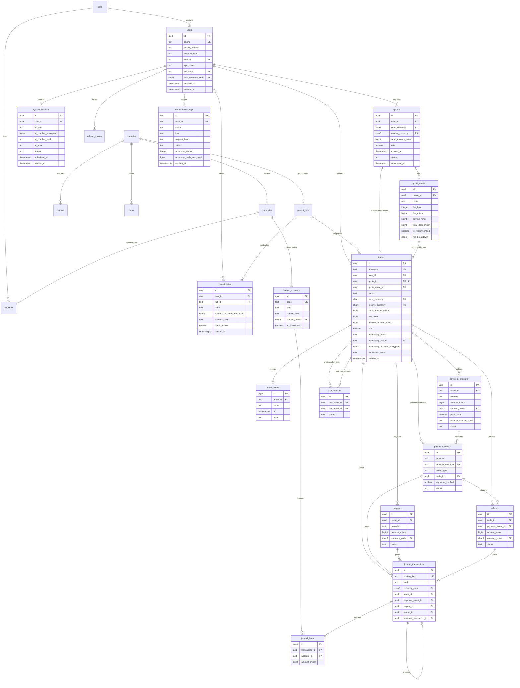

# CrossPay B1 entity relationship diagram

The diagram is grouped by responsibility. Cardinality is the enforcement in the
migrations; `RESTRICT` and soft-delete rules are described in
`db/migrations/`.

## Invariants not visible in the ERD

- A quote belongs to one user and can be consumed by at most one trade
  (`trades.quote_id` is unique).
- A trade route must belong to the same quote
  (`(quote_route_id, quote_id)` composite foreign key).
- `trade_events` is written by the `trades` trigger and is append-only.
- `trade_status_transitions` controls every status update.
- Every `journal_transactions` row is single-currency; its lines must sum to
  zero and use accounts of that currency. The check is a deferred constraint
  trigger, so it runs at commit.
- `journal_transactions` and `journal_lines` reject `UPDATE` and `DELETE`.
- `posting_key` is unique, which makes a retried provider callback harmless.
- Balances come from `ledger_account_balances`; no spendable wallet is stored.
